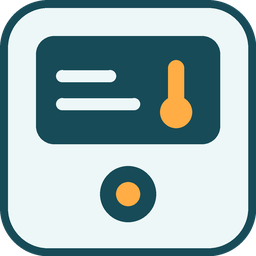
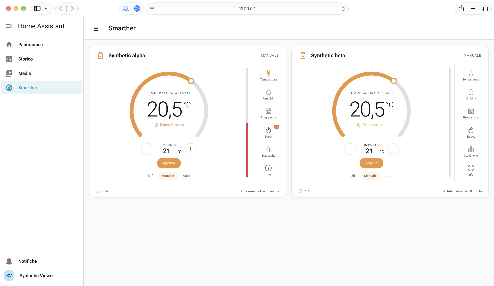
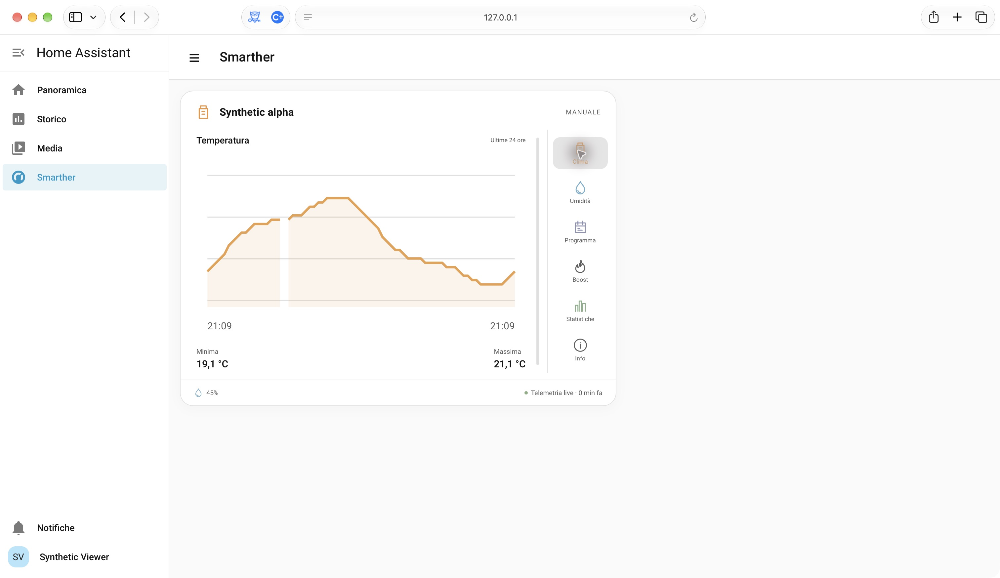

# BTicino Smarther MQTT for Home Assistant

A community integration for first-generation BTicino Smarther thermostats. It
provides climate readings, heating diagnostics, program selection and Boost
controls. Setup and options forms are available in English and Italian; entity
names currently use English.

Home Assistant MQTT and a separately configured TLS Mosquitto bridge connect to
the manufacturer's remote MQTT service. No BTicino, Legrand or Netatmo developer
application registration or developer OAuth token is required. The integration
does not continuously read state through developer REST APIs and therefore does
not consume their API call allowances, which can limit continuous home automation.
It still depends on valid bridge credentials, network connectivity and availability
of the remote MQTT service; service terms and broker-side limits may apply.

## Compatibility

The current release is **v0.1.2**. It includes an automatically registered Smarther
sidebar panel with one thermostat card per visible device, temperature and
humidity history charts, recorded heating statistics and a Boost countdown.
See [panel guide](docs/DASHBOARD.md).

- **Smarther V1:** MQTT compatibility was verified on one first-generation
  BTicino device in the X8000/X800W family (including X8000W), originally
  managed by the Thermostat app. Individual V1 product codes have not all been independently tested.
- **Smarther2 with Netatmo:** not yet verified; uses Home + Control.
- **Smarther AC with Netatmo:** not yet verified; uses Home + Control.

Other models might work, but app and backend protocol differences need evidence
and model-specific testing. Sanitized protocol evidence is welcome. See BTicino's
[Smarther2 catalogue](https://www.bticino.it/sites/default/files/2025-04/catalogo-smarther2.pdf),
[first-generation manual](https://dar.bticino.it/asset/Documents/RA00158AF_U_EN.pdf),
and [Smarther AC product information](https://www.bticino.com/news/smarther-ac-with-netatmo).

The [GitHub Releases](https://github.com/alescim17/smarther/releases) page lists
published versions. Pre-releases require an explicit Marketplace opt-in; official
catalog listing is a separate process.

## Requirements

**New installation?** Start with the [illustrated first-time setup guide](docs/FIRST_TIME_SETUP.md).
The MQTT bridge is a **one-time private prerequisite**, not a field in the integration wizard.

Home Assistant **2026.11.0+**, its MQTT integration, a broker and a compatible
thermostat with an independently validated TLS-authenticated bridge are required.
This integration does not retrieve vendor credentials or manage the broker.
The [Android log method](docs/ANDROID_APP_LOGS.md) described in older community
documentation is included for reference, but its availability in current Android
apps is **unverified**. See the [bridge prerequisites](docs/MOSQUITTO_BRIDGE.md).

New entries are read-only. Setup, reconnect and update do not issue thermostat
commands. Enable controls explicitly only after isolating other writers and
verifying bridge routing and fresh device telemetry. MQTT publish success alone
does not prove a physical command was applied. Off requests protection/antifreeze.

## Installation sequence

1. Start with the [illustrated first-time setup guide](docs/FIRST_TIME_SETUP.md).
   Obtain authorized bridge credentials privately; the
   [historical Android log procedure](docs/ANDROID_APP_LOGS.md) is not verified
   for modern Android apps. **Never share logs or vendor credentials publicly.**
2. [Configure the Mosquitto bridge](docs/MOSQUITTO_BRIDGE.md) with verified TLS
   and **exact inbound telemetry topics**. The published template intentionally
   does not forward outgoing thermostat SET messages.
3. Confirm Home Assistant's MQTT integration and fresh, non-retained device state.
4. Install and configure Smarther with just the device name and exact topic
   prefix; new entries start **read-only**.
5. Open **Smarther** in the sidebar. The panel is registered automatically:
   no dashboard creation, JavaScript resource registration or YAML is needed.
   In the device's Options, **Show this thermostat in the Smarther panel** lets
   you hide it. This flag is on by default and never enables commands.

## Install

Add this public repository to Home Assistant Marketplace/HACS as an integration
repository and select a compatible version from its published releases. To use
a beta, enable pre-releases for the repository. Follow any displayed restart
instruction, then open Settings → Devices & services → Add integration →
BTicino Smarther MQTT.

Enter a name and the exact private prefix ending before `/device_state`, including
the leading slash. A generic example is `/cro/plantid/EXAMPLE/gwid/EXAMPLE`.
Do not enter credentials, wildcards or command suffixes. Wait for actual telemetry
and keep controls disabled until the independent command-safety checks pass.

For isolated evaluation, manually copy `custom_components/bticino_smarther_mqtt`
into the test HA configuration and follow its normal custom-integration loading
process. Private repositories are not supported by the public HACS path.

## Update, history and rollback

Read [the update guide](docs/UPDATE.md). Keep the existing config entry,
options, entity IDs, device ID and Recorder history; do not delete and re-add
the thermostat for a normal update. Back up first and retain a previous
compatible native version for rollback.

## Automatic Smarther panel

*Isolated demonstration with synthetic devices and readings.*

After normal integration setup, **Smarther** appears in the sidebar and shows all
visible configured thermostats, using their actual entity registry IDs. Each
widget includes current/target temperature, mode, program, Boost 30/60/90 and
cancel, humidity, heating, Boost end and live/stale telemetry. Commands require
controls to be enabled and a reported thermostat state; older or retained data
are flagged but do not by themselves block commands. Opening the panel sends no commands.

The panel uses a compact thermostat face inspired by the original Smarther
card: a large temperature dial, discreet setpoint controls, a narrow Boost
indicator and side shortcuts. Temperature/humidity charts show the last 24 hours;
heating statistics show recorded minutes over seven local calendar days. Missing
or stale intervals are excluded rather than counted as heating.
The red Boost bar shows remaining time on a 0–90 minute scale and empties as
the reported end time approaches.

*Example temperature history with synthetic data.*

This is a self-contained widget close to HA's native thermostat appearance,
with the same rendering on direct entry and after browsing dashboards. No
third-party cards, CSS patches to HA components or extra user setup are required.

**Show this thermostat in the Smarther panel** is on by default in each device's
Options. Turning it off hides that device; hiding all devices removes the menu
entry. Showing one again restores it automatically. Visibility changes do not
reconnect MQTT, enable commands or change existing user dashboards. Users only
see entity mappings they have permission to read.

The panel is managed by the integration. It is not an editable Lovelace dashboard.
The existing [native-card example](custom_components/bticino_smarther_mqtt/examples/dashboard.yaml)
remains an optional route for users who want their own dashboard; it is not needed
to use Smarther. See [panel behavior and visibility](docs/DASHBOARD.md).

## Development and acknowledgments

The idea, requirements and technical direction of this integration were
human-led. The native Home Assistant implementation was written predominantly
with AI coding tools, including Codex, with human supervision and validation
on a real first-generation Smarther thermostat. The maintainer remains
responsible for reviewing and maintaining the released integration.

This project builds on the earlier community-developed YAML/MQTT Smarther
solution. **Original YAML/MQTT project contributors:** Daniele (GitHub
username: `Danye`). Other original collaborators will be acknowledged as
they confirm their preferred credit.

## Help and attribution

Use the issue tracker of the approved public distribution. Share only sanitized
version/error information, never credentials, device identifiers, prefixes or raw
MQTT payloads. A broker connection alone does not prove the vendor bridge is live.

[MIT licensed](LICENSE), preserving [attribution and provenance](docs/PROVENANCE.md).
The geometric icon is original project artwork. This community project is not
affiliated with or endorsed by BTicino, Legrand, Netatmo or Home Assistant.

