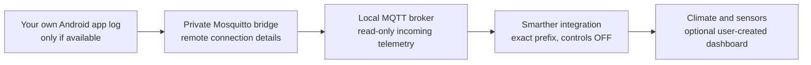

# Legacy Android log method: finding MQTT bridge details

> **Compatibility notice (historical, unverified today).** The original
> BTicino Thermostat / Smarther community README described the procedure
> below for some Android app versions. We have **not verified** that today's
> Android apps still create or expose these files. This is not a guaranteed
> vendor-supported credential export and should not be described as one.

## What you need, and what goes where

The **vendor-cloud Mosquitto bridge** needs the remote broker hostname and
port, a unique compatible remote client ID, remote username/password and
exact device topics. **BTicino Smarther MQTT in Home Assistant** only asks for
the thermostat's name and its **exact topic prefix**. It does not accept
remote service credentials or create the bridge.



## Historical procedure on your own Android phone

1. Open the phone's ordinary **Files** application (or the Android file
   manager permitted to access your documents). Look for the folder
   `Documents/Chronotermostat/` in shared storage. Folder availability and
   names vary by app and Android version.
2. If that folder exists, look for a date-stamped file matching
   `Eliot_Thermostat_PrtLogYYYY_MM_DD.txt`, as described in the older
   community instructions. Use the latest suitable file **privately**.
3. Inside the file, search for `cDeviceManager.TryConnectMQTT`. The
   historical format, represented with **entirely fictional values**, is:

   ```text
   [cDeviceManager.TryConnectMQTT] Try connect to tcp://mqtt.example.invalid:8883 with ID/usr/pwd:EXAMPLE_CLIENT,example-user,EXAMPLE_PASSWORD
   ```

   Read the hostname/port and the values following `ID/usr/pwd:` into your
   **private** bridge notes. The sample account, domain and password above
   are placeholders, not working credentials.
4. Search for `cDeviceManager.SubscribeMQTT`. The older guide illustrated
   a subscription like:

   ```text
   [cDeviceManager.SubscribeMQTT] Subscribed to /cro/plantid/EXAMPLE/gwid/EXAMPLE/#
   ```

   For the Home Assistant integration, remove the subscription wildcard
   `/#` (and any optional final `/`). The resulting **fictional** example
   to enter in the UI is `/cro/plantid/EXAMPLE/gwid/EXAMPLE`. Preserve the
   **leading slash**. Do not include `/device_state` or `/set`.
5. If multiple devices appear, identify each intended device's prefix
   separately rather than using a wildcard over the whole account.

| Historical field | Destination | Confidential? |
| --- | --- | --- |
| MQTT host and port | Mosquitto `address` as `host:port`, not a URL | Treat as private installation configuration |
| Client ID | Mosquitto `remote_clientid`, distinct from other active sessions and accepted by the remote service | Yes |
| Remote username | Mosquitto `remote_username` | Yes |
| Remote password | Mosquitto `remote_password` | **Yes: secret** |
| Subscription topic | Used to derive **exact** bridge telemetry paths and the integration's prefix | **Yes: identifies your installation** |

The old documentation suggested modifying the last character of a client ID
to avoid a collision. **Do not assume arbitrary client IDs are accepted**
by current vendor services; use an authorized, compatible, distinct value.

## If the folder or log is missing

Android's storage protections and app behavior can prevent an older log path
from existing or being visible. Do **not** root the phone, bypass app storage
protection, harvest another person's credentials or attempt interception.
There is **no alternative current-app credential retrieval method qualified
by this project**. Check official vendor support and documentation, or
use credentials and topics from an already authorized private bridge
configuration that you control. Without valid bridge credentials, setup may
create entities but cannot establish the remote data path.

## Configure the bridge safely

Continue with the [Mosquitto bridge guide](MOSQUITTO_BRIDGE.md). The published
example deliberately forwards only **four exact incoming telemetry topics**,
not the historical wildcard `both` rule. It does not configure an outgoing
command route. Thermostat control must remain disabled until a separate,
explicit physical-command routing and retained-message safety decision.

**Keep the entire log file private.** It may contain identifiers, account
information, credentials, timestamps and unrelated data. Do not paste it into
GitHub issues, screenshots, CI logs, public chats or bug reports. If leaked,
rotate affected credentials using an authorized vendor procedure.

## Illustrations and provenance

The directory and log fragments above are deliberately **synthetic diagrams
and redacted examples**, derived from the historical README's terminology.
Old screenshots are **not copied**: some archived images may contain device
identifiers, and their redistribution/privacy clearance is not established.
New screenshots may be contributed only after full redaction and rights review.
