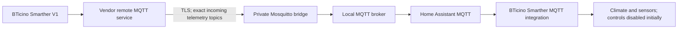

# First-time setup: Smarther MQTT for Home Assistant

> **One-time setup.** The BTicino cloud MQTT bridge is configured in **Mosquitto**, not in the Smarther integration wizard. Keep credentials private. Once it is working, routine integration upgrades **do not** require setting up the bridge again.

## What this guide covers

Verified MQTT operation: **one first-generation BTicino Smarther V1** in the X8000/X800W family. Other V1 SKUs have not all been individually tested. Smarther2 with Netatmo and Smarther AC with Netatmo are **not yet verified**. This is a community integration, not an official BTicino integration.

You will need Home Assistant **2026.11.0+**, a local MQTT broker (for example the Mosquitto add-on), the Home Assistant MQTT integration, a first-generation Smarther device, and authorized details for the remote vendor MQTT service. The integration does **not** obtain or manage vendor credentials or bypass service restrictions.

## Connection diagram



**Important:** this is **cloud-dependent**, not local-only. The bridge imports telemetry only in the documented baseline. It does not provide a route to send thermostat commands.

## Step 1 — Obtain your own bridge details privately

Collect the remote MQTT hostname/port, a valid **distinct** remote client ID, remote username/password, and the exact topic prefix for **your own** device. If you have an existing authorized bridge configuration, reuse its verified information privately.

The [illustrated historical Android Thermostat log guide](ANDROID_APP_LOGS.md) documents an older method. **Its file location and availability are not verified on current Android versions**; it is neither a guaranteed export procedure nor a way to retrieve third-party credentials. If the log is missing and you have no authorized working details, stop here and consult official vendor support rather than guessing client IDs or credentials.

Never place passwords, device IDs, real MQTT prefixes, application logs, or bridge configuration files in a public repository, issue, screenshot, or support request.

## Step 2 — Set up the local broker and the TLS bridge (once)

1. Install/configure a suitable MQTT broker and the standard **MQTT** integration in Home Assistant. Confirm that Home Assistant can connect to its local broker.
2. On **Home Assistant OS** with the **Mosquitto broker** add-on, enable the add-on's custom configuration options:

   ```yaml
   customize:
     active: true
     folder: mosquitto
   ```

   Keep private custom Mosquitto `.conf` files in the add-on's configured `/share/mosquitto/` folder. On other installations, use the corresponding private Mosquitto configuration location. **Do not** put vendor credentials into `secrets.yaml` expecting Mosquitto to read that file automatically.
3. Use the [complete bridge template and TLS safety guidance](MOSQUITTO_BRIDGE.md). Substitute **only your authorized values**, keep TLS certificate validation enabled, and use **exact** incoming telemetry subscriptions: `/device_state` and the supported `/device_profile/01`, `/02`, and `/03` under your device prefix. The template intentionally contains **no outgoing `/set` topic** and no wildcard bidirectional forwarding.
4. Back up any pre-existing broker configuration before changes. Apply broker settings through the normal supported add-on/service procedure, and inspect its **private** connection/TLS logs. A running local broker alone does not prove the cloud bridge is connected.

Example **fictional prefix** for documentation only:

```text
/cro/plantid/EXAMPLE/gwid/EXAMPLE
```

The leading `/` matters. This is a prefix, **not** a complete `/device_state` topic and **not** a `/#` wildcard.

## Step 3 — Verify fresh read-only telemetry

Using your own MQTT diagnostics, check for an actual **fresh, non-retained** `/device_state` message at the expected prefix. Compare its observed temperature/mode with the device or an existing trusted controller. Do not publish any command or clear retained messages just to test installation.

If no fresh telemetry arrives, check the exact topic, remote bridge connection, certificate, broker credentials, client-ID collision, and network connectivity privately. Do not proceed on a stale retained message alone.

## Step 4 — Install and configure the integration

1. In Home Assistant **Marketplace**, add [this public repository](https://github.com/alescim17/smarther) as an **Integration** if it is not yet in your default catalog. Choose a compatible published release; beta builds require explicitly including **pre-releases**.
2. Install the release and restart Home Assistant **only when requested**.
3. Go to **Settings → Devices & services → Add integration → BTicino Smarther MQTT**.
4. In the short wizard, enter a **thermostat name** and the **exact device MQTT topic prefix** from Step 2. Do not enter vendor usernames/passwords, a trailing `/device_state`, `/set`, or `/#`.
5. Confirm that new climate and sensor entities receive fresh data. The integration creates new entries **read-only by default**. Do not enable control commands until the bridge's outgoing routing and single-writer safety have been separately verified.

**Existing installations:** do not add a second config entry or delete and re-add the thermostat to update it. Use the existing entry and [update/rollback instructions](UPDATE.md) to preserve entity IDs, device identity, and Recorder history.

## Step 5 — Optional dashboard

Home Assistant's built-in thermostat card works with the climate entity. For an optional manually maintained dashboard, use the [dashboard guide](DASHBOARD.md). The integration never creates, deletes, or modifies your dashboards automatically.

## Quick troubleshooting

| Symptom | First check |
| --- | --- |
| Wizard says MQTT is not ready | Configure the standard Home Assistant MQTT integration and local broker first |
| Integration loads but has no fresh readings | Remote bridge state, TLS, exact topic prefix, fresh non-retained messages |
| Prefix is rejected | Preserve the leading slash; omit `/device_state`, `/set`, `+`, and `#` |
| Thermostat commands unavailable | Expected read-only default; command routing is **not** configured by this guide |
| An upgrade changes the installation | Retain existing config entry; use [update/rollback](UPDATE.md), not a new onboarding |

The remote service and its restrictions can change. Never share private connection details to troubleshoot publicly.
